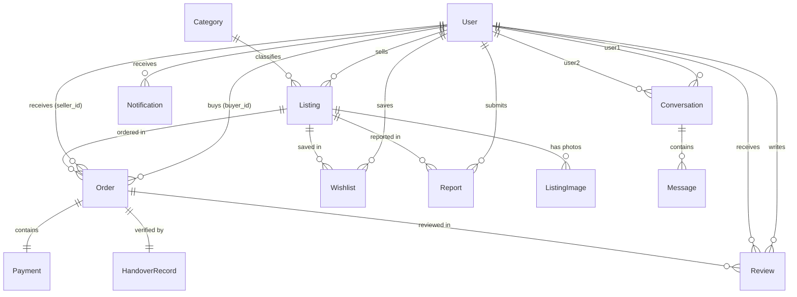

# PassItOn – Campus Edition
> **"One student's unused item becomes another student's useful item."**

A complete, runnable full-stack student-to-student campus marketplace web application built with **Python Flask**, **SQLite (SQLAlchemy)**, **Bootstrap 5**, **Chart.js**, and **QR verification**.

Designed specifically for college campuses to enable students to buy, sell, and reuse academic textbooks, scientific calculators, laboratory equipment, engineering drawing instruments, hostel essentials, and sports gear safely and affordably.

---

## 🌟 Key Features

### 1. Campus Authentication & Student Profiles
- Student registration with campus-specific fields: **Name, Email, Phone, Department, Year/Semester, and College**.
- Strict server-side and client-side form validation (email format, password length, phone pattern).
- Passwords securely hashed with **Werkzeug**; CSRF protection on all forms via **Flask-WTF**.
- **Password Reset Simulation**: Designed for offline viva evaluations with no SMTP server — generates a secure reset token and prints the link both to the terminal and on-screen in a test alert.
- **Student Profile**: Shows personal academic info, campus rating & reviews, active listings, sold history, and payment configuration.
- **Account Suspension**: Campus administrators can instantly suspend abusive accounts; blocked users are barred from logging in.

### 2. Rule-Based Smart Price Suggestion Engine
- Algorithmic valuation calculated live as the student types (AJAX / JavaScript):
  - **Condition Factors**: New (80–90% of MRP), Like New (65–80%), Good (45–65%), Used (25–45%).
  - **Age Depreciation**: Deducts ~1.5% per month of item age (up to a 30% cap).
  - **Campus Category Benchmark**: Dynamically blends the item's depreciated MRP (75%) with the current average selling price of similar category listings in the campus database (25%).
- Provides a live suggested range (e.g. `₹450 – ₹600`) and a **1-click button** to populate the price input field.

### 3. Campus Listings & Category Navigation
- 11 pre-seeded categories: **Books, Electronics, Calculators, Stationery, Lab Equipment, Furniture, Clothing, Accessories, Sports Items, College Supplies, Other**.
- Multi-photo upload support (stored in `static/uploads/listings` with secure unique filenames and Pillow image optimization).
- Comprehensive listing details: image gallery, price vs. original MRP, discount percentage, condition badge, views count, seller info, and campus meetup location.
- Automatic **Similar Items** recommendation carousel on every item page.

### 4. Advanced Search & Filtering
- Search across title, description, and campus location.
- Filter by: **Category, Condition, Price Range (Min/Max ₹), Department, and Location**.
- Sort options: **Newest First, Price: Low to High, Price: High to Low, Most Popular (Views)**.
- Clean pagination (12 items per page) and responsive empty states.

### 5. Campus Wishlist
- 1-click heart toggle to save listings.
- Dedicated Wishlist page in user dashboard.
- **Availability Alert**: Automatically highlights items that have become **Reserved** or **Sold Out** by another student.

### 6. Order Request Lifecycle & Reservation
- Multi-step status progression with interactive timeline:
  `Request Sent` ➔ `Seller Accepted` ➔ `Payment Pending` ➔ `Payment Completed` ➔ `Payment Confirmed` ➔ `Handover Pending` ➔ `Completed`
- Accepting a request automatically sets the listing to `Reserved`, preventing double-booking by other buyers.
- Rejection or cancellation safely returns the listing to `Available`.

### 7. Demo UPI / GPay QR Payment Flow
- **Prototype Banner**: Displays prominent disclaimer stating it is a simulation for academic demonstration.
- Sellers can save their UPI ID (VPA) or upload their personal UPI QR image in their profile.
- When UPI payment is chosen, buyer is presented with the seller's UPI ID, payment amount, and a scannable QR code.
- Buyer enters their **UTR / Reference ID** and marks payment completed.
- Seller reviews the reference ID and clicks **Confirm Payment Received** (or flags as not received).

### 8. Secure QR Handover Verification
- Once payment is confirmed (or immediately if Cash is selected upon acceptance), the server generates a single-use encrypted **Handover QR code** with a unique secure token (e.g., `HANDOVER-xxxx...`).
- When students meet on campus:
  - Buyer displays the QR code on their phone screen.
  - Seller opens the verification page and scans the QR code using their camera (powered by `html5-qrcode`).
  - **Manual Fallback**: If camera access is disabled, seller can type the printed token directly.
- Upon verification, the token is invalidated, the order status becomes `Completed`, the item is marked `Sold`, and both parties are notified.

### 9. Student-to-Student Direct Chat
- In-platform messaging between buyers and sellers.
- Automatically creates a conversation with a reference card showing the item title, image, and price.
- Live AJAX polling (every 3.5 seconds) with auto-scroll and instant message dispatch.
- Navbar badge shows live count of unread messages.

### 10. Reviews & Ratings System
- Mutual feedback: After a completed handover, both the buyer and seller can rate each other (1 to 5 stars) and write a short review.
- Ratings can only be submitted once per order.
- Average star rating and reviews are displayed on student profile pages and listing detail cards.

### 11. Campus Safety Center & Moderation Reports
- Dedicated Campus Safety Guide detailing safe meetup locations (Library lawn, Cafeteria, Department lobbies), pre-payment testing, and QR security.
- Students can report fraudulent listings or suspicious users with categorized reasons (Fake, Wrong Info, Scam, Inappropriate).
- Administrators can review, dismiss, or resolve reports, with 1-click actions to delete listings or suspend student accounts.

### 12. User Dashboard
- **Overview**: At-a-glance metrics (Active Listings, Sold Items, Requests Received, Purchases, Wishlist count, Average Rating).
- **My Listings**: Tabbed management for Available, Reserved, and Sold items with Edit, Delete, and Mark Sold options.
- **Requests Received**: Accept or decline incoming purchase requests.
- **My Purchases**: Track order lifecycle, access Handover QR, and review sellers.
- **Notification Center**: Bell icon with unread count and full list with 1-click mark-all-read.

### 13. Admin Dashboard & Chart.js Analytics
- Protected `/admin` area restricted to users with `role='admin'`.
- Real-time KPI cards: Total Students, Total Listings, Active Listings, Items Sold, Total Demo Volume (₹), Pending Reports.
- **Chart.js Visualizations**:
  - Doughnut Chart: Active listings distribution across categories.
  - Bar Chart: Orders breakdown across lifecycle stages.
  - Pie Chart: Breakdown of item condition grades (New, Like New, Good, Used).
- Moderation tools for Users, Listings, Transactions Audit, Categories (Add/Edit/Delete), and Reports.

---

## 🛠️ Tech Stack

| Component | Technology | Description |
| :--- | :--- | :--- |
| **Backend** | Python 3.14 + Flask | Modular structure using Flask Blueprints |
| **Database** | SQLite + SQLAlchemy | Relational schema with foreign keys and cascading relationships |
| **Authentication** | Flask-Login + Werkzeug | Session management, password hashing, role-based access |
| **Form & CSRF** | Flask-WTF + WTForms | Server-side validation, CSRF tokens, file upload constraints |
| **QR Generation** | `qrcode` + Pillow | Dynamic generation of Handover and UPI QR codes |
| **QR Scanning** | `html5-qrcode` | Client-side camera QR scanning with manual code fallback |
| **Frontend** | Jinja2 + Bootstrap 5 | Responsive UI with custom college-themed CSS (`style.css`) |
| **Charts** | Chart.js | Interactive dashboard analytics for administration |
| **Testing** | `unittest` | Automated end-to-end integration test suite |

---

## 📂 Project Structure

```
c:\campus\
├── app/
│   ├── __init__.py           # Flask app factory, extensions, error handlers, context processors
│   ├── config.py             # App configuration, database URI, upload limits
│   ├── models.py             # SQLAlchemy models (User, Listing, Order, Payment, Handover, etc.)
│   ├── forms.py              # Flask-WTF forms for auth, listings, orders, reviews, reports
│   ├── utils.py              # File upload, QR generation, smart price algorithm, notifications
│   ├── routes/
│   │   ├── __init__.py
│   │   ├── auth.py           # Register, login, logout, password reset, profile edit, report user
│   │   ├── main.py           # Homepage, campus safety guide, about page
│   │   ├── listings.py       # Browse, search/filters, create, edit, delete, smart price API
│   │   ├── orders.py         # Request flow, accept/reject, demo UPI, QR handover, reviews
│   │   ├── chat.py           # Student messaging, live polling API
│   │   ├── dashboard.py      # User dashboard (listings, requests, purchases, wishlist, notifs)
│   │   └── admin.py          # Admin dashboard, stats API, users, listings, categories, reports
│   ├── static/
│   │   ├── css/
│   │   │   └── style.css     # Custom college-themed styling, cards, timeline, badges
│   │   ├── js/
│   │   │   ├── main.js       # Auto-dismiss alerts, wishlist toggle AJAX, image preview
│   │   │   ├── smart_price.js# Live debounced Smart Price calculation
│   │   │   ├── chat.js       # Live message polling and auto-scroll
│   │   │   ├── qr_scanner.js # html5-qrcode camera integration + manual fallback
│   │   │   └── admin_charts.js# Chart.js analytics for admin overview
│   │   └── uploads/          # Static file uploads (listings, avatars, upi_qrs, handover_qrs)
│   └── templates/
│       ├── base.html         # Base layout with navbar, alerts, footer
│       ├── index.html        # College-themed homepage with stats, categories, featured items
│       ├── safety.html       # Campus safety guidelines and meetup checklist
│       ├── about.html        # Project mission and technical architecture
│       ├── auth/             # Login, register, forgot/reset password, profile, edit profile
│       ├── listings/         # Browse list, create (with smart price), edit, detail, report
│       ├── orders/           # Request form, tracking detail, scan QR, review
│       ├── chat/             # Direct messaging view
│       ├── dashboard/        # Overview, my listings, requests received, purchases, wishlist
│       ├── admin/            # Admin overview, users, listings, transactions, categories, reports
│       └── errors/           # 403, 404, 500 error pages
├── instance/
│   └── campus.db             # SQLite database
├── seed.py                   # Pristine sample database seeder (1 admin, 8 students, 25 items, orders)
├── run.py                    # Application launch script (http://127.0.0.1:5000)
├── test_app.py               # Complete integration test suite (all 7 tests passing)
├── requirements.txt          # Python dependencies
├── .env.example              # Sample environment variables
└── README.md                 # Complete documentation
```

---

## 🗄️ Database Schema & Relationships



---

## 🚀 Setup & Run Instructions

### 1. Prerequisites
- Python 3.10+ (Tested and verified on Python 3.14)
- Pip package manager

### 2. Installation
Open your terminal inside the project directory (`c:\campus`):
```bash
python -m pip install -r requirements.txt
```

### 3. Seed Database
Initialize and seed the database with categories, admin, 8 students, 25 realistic campus listings with pre-rendered photo cards, and sample orders:
```bash
python seed.py
```

### 4. Run the Application
Start the Flask development server:
```bash
python run.py
```
Open your browser and navigate to:
👉 **`http://127.0.0.1:5000`**

### 5. Run Automated Test Suite
To verify that all 7 end-to-end integration tests pass:
```bash
python test_app.py
```

---

## 🔑 Demo Credentials

All test accounts are pre-seeded with realistic data and pre-generated profile pictures:

| Role | Name | Email | Password | Department & Details |
| :--- | :--- | :--- | :--- | :--- |
| **Admin** | Campus Administrator | `admin@campus.edu` | `Admin@123` | Dean of Student Welfare (Full Moderation Access) |
| **Student** | Aarav Sharma | `aarav@campus.edu` | `Student@123` | Computer Science, 3rd Year (Seller of Casio Calc, DSA Book) |
| **Student** | Priya Patel | `priya@campus.edu` | `Student@123` | Electronics & Comm, 4th Year (Seller of Arduino Kit, Multimeter) |
| **Student** | Rohan Verma | `rohan@campus.edu` | `Student@123` | Mechanical Engg, 2nd Year (Seller of Mini Drafter, Bicycle) |
| **Student** | Ananya Iyer | `ananya@campus.edu` | `Student@123` | Information Technology, 3rd Year (Buyer of Casio Calc) |
| **Student** | Vikram Singh | `vikram@campus.edu` | `Student@123` | Civil Engineering, 4th Year (Buyer of B.S. Grewal Book) |
| **Student** | Sneha Reddy | `sneha@campus.edu` | `Student@123` | Biotechnology, 2nd Year (Seller of Lab Coat, Goggles) |
| **Student** | Kabir Mehta | `kabir@campus.edu` | `Student@123` | MBA / Business, 1st Year (Seller of Placement Blazer) |
| **Student** | Divya Nair | `divya@campus.edu` | `Student@123` | Architecture & Design, 3rd Year (Seller of Cutting Mat) |

*(Tip: The Sign In page includes a 1-click Quick Login bar for instant credential filling during presentations).*

---

## 🔄 End-to-End Demo Workflows

### Flow A: Buyer Flow
1. Open `http://127.0.0.1:5000` and sign in as **Ananya** (`ananya@campus.edu` / `Student@123`).
2. Search for `"Arduino"` or browse the **Electronics** category.
3. Click on the Arduino Uno Starter Kit (listed by **Priya**).
4. Click **Chat with Seller** to ask a question, or click **Buy / Request Item**.
5. Select **UPI / GPay Demo QR Code**, write an optional meeting note, and submit the request.
6. Once Priya accepts the request, visit the Order Tracker page.
7. View Priya's UPI ID and QR code, enter a reference ID (e.g. `UPI/20261117/8899`), and click **I Have Completed Payment**.
8. After Priya confirms receipt, your **Handover QR Code** appears with a unique security token.
9. Meet Priya on campus and present your QR code for scanning.
10. Once verified, submit a 5-star rating and review.

### Flow B: Seller Flow
1. Sign in as **Aarav** (`aarav@campus.edu` / `Student@123`).
2. Click **Sell an Item** in the top navigation bar.
3. Fill in the title, choose **Calculators**, select **Good** condition, and enter original price `₹1,200` with age `6` months.
4. Watch the **Rule-Based Smart Price Suggestion** box automatically compute a fair suggested range (e.g. `₹480 – ₹620`).
5. Click **Apply Suggested Price** to automatically populate the selling price.
6. Choose a campus handover spot (e.g. `Central Library`) and click **Publish Listing**.
7. When an incoming order arrives, accept it from your **Requests Received** dashboard tab.
8. Confirm payment receipt, then click **Scan or Enter Handover Code** to verify the buyer's QR code.

### Flow C: Admin Moderation Flow
1. Sign in as **Admin** (`admin@campus.edu` / `Admin@123`).
2. Access the **Admin Panel** from the user dropdown.
3. Review key metrics and **Chart.js** charts (Category distribution and Order status breakdown).
4. Visit **Users** to view student accounts and test the **Suspend / Reactivate** toggle.
5. Visit **Reports** to inspect student complaints, add administrative resolution notes, and resolve or dismiss flags.
6. Visit **Categories** to add new campus categories or modify existing ones.

---

## 🛡️ Campus Safety Guidelines
- Physical handovers must take place in high-visibility campus areas (e.g., Central Library, Cafeteria, Department corridors).
- Buyers should inspect physical items (testing calculator keys, plugging in electronics) before completing payments.
- Never share bank OTPs or email passwords.
- Always conclude transactions through the QR Handover verification step.

---

## 📄 License
Academic Mini-Project for college evaluation. Free to run and customize for educational purposes.
# PassItOn-campus-edition
